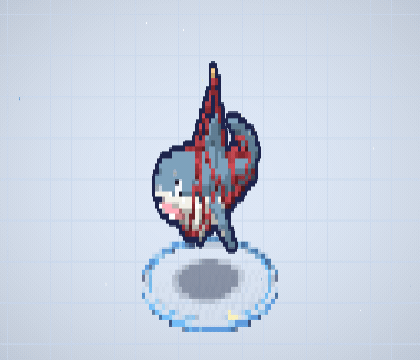
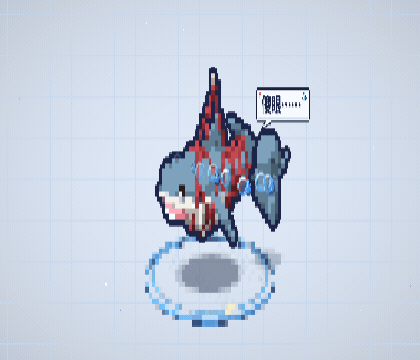
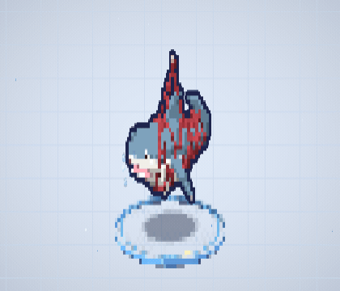
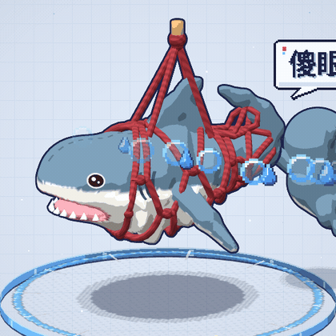

# BLÅHAJ KIKKOU 3D Viewer

**IKEA サメ（Blåhaj）亀甲縛り ＆「傻眼……」目撃サメ 3D インタラクティブビューワー**  
**Full-3D GPU リグ版（`TWIST` × `PIXEL+AA` × `DOT SIZE 2.60` 標準）・60 FPS・単体 HTML 完結**

  
  
  
  
  

  <a href="https://kuraneko1.github.io/blahaj-kikkou-3d/"><b>🚀 Live Demo (`TWIST` + `PIXEL+AA 2.6`)</b></a> &nbsp;|&nbsp;
  <a href="https://kuraneko1.github.io/blahaj-kikkou-3d/smooth.html">Smooth AA 版</a> &nbsp;|&nbsp;
  <a href="https://kuraneko1.github.io/blahaj-kikkou-3d/pseudo3d.html">128 スライス疑似 3D 版</a>

---

外部ライブラリ・サーバー一切不要の**単体 1 ファイル HTML（`802 KB`）**に、60° 亀甲縛り・しっぽの絡め結び・お腹の綿のぷっくり食い込み・吊り紐ねじれ物理・3D 目撃サメ＆「傻眼……」吹き出し・全 6 モーション・ブラウザ内 `.GLB` / `.PNG` 書き出し機能を内蔵しています。

<table>
  <tr>
    <td align="center" width="50%">
       
      <b>5. TWIST（既定：PIXEL+AA / DOT SIZE 2.60）</b> 
      吊り紐ねじれ＆360°ターンテーブル回転・ぐるぐる目＋火花演出
    </td>
    <td align="center" width="50%">
       
      <b>1. DUMBFOUND（3D 目撃サメ + 傻眼……）</b> 
      周囲を泳ぎ回る 3D 目撃サメ＋頭上追従ピクセル吹き出し
    </td>
  </tr>
  <tr>
    <td align="center" width="50%">
       
      <b>4. CHOMP（ガブッと顎アクション）</b> 
      ジト目キリッと＋顎ボーン開閉＆先端水しぶき FX
    </td>
    <td align="center" width="50%">
       
      <b>Full-3D 全周＆上下チルト（Smooth AA）</b> 
      `-85°〜+90°` 全角度対応 3D 台座＆お腹の裏まで陰影統一
    </td>
  </tr>
</table>

  

---

## 収録ファイル一覧

| ファイル | 形式 / 容量 | 特徴・初期設定 |
| :--- | :--- | :--- |
| [`index.html`](./index.html) | **単体 HTML（`802 KB`）** | **既定：`5. TWIST`・`PIXEL+AA`・`DOT SIZE 2.60`** / 60 FPS Full-3D GPU リグ |
| [`smooth.html`](./smooth.html) | 単体 HTML（`802 KB`） | 既定：`1. DUMBFOUND`・`SMOOTH AA` / 同じモデルの滑らかシェーディング版 |
| [`pseudo3d.html`](./pseudo3d.html) | 単体 HTML（`4.1 MB`） | 128 スライス・スプライトスタッキング版（24 FPS / `.ap3d` 読込＆書き出し対応） |
| [`models/blahaj-kikkou-full3d.glb`](./models/blahaj-kikkou-full3d.glb) | glTF 2.0 Binary（`765 KB`） | Blender / Unity 等ですぐ使える亀甲縛り Blåhaj 3D モデル（38,624 tris） |
| [`models/witness-shark-full3d.glb`](./models/witness-shark-full3d.glb) | glTF 2.0 Binary（`284 KB`） | 目撃サメコンパニオン 3D モデル（14,464 tris） |
| [`models/blahaj-shibari-3d.ap3d`](./models/blahaj-shibari-3d.ap3d) | `.ap3d` パッケージ（`3.0 MB`） | 疑似 3D スプライトスタック全 6 モーションパッケージ |

## 操作方法

- **ドラッグ**: 360° 水平回転 ＆ `-85° 〜 +90°` 上下チルト（裏側の亀甲結び＆フロストガラス台座まで確認可能）
- **ホイール**: ズームイン / アウト
- **`1`〜`6` / `[` `]`**: モーション切替（`1. DUMBFOUND` / `2. DANGLE` / `3. STRUGGLE` / `4. CHOMP` / `5. TWIST` / `6. BUNGEE`）
- **`SPACE`**: 再生 / 一時停止（タイムラインの個別フレームクリック＆スクラブも可）
- **`F` / `B` / `R`**: 顔アップ（`FACE`） / ぷるん弾み（`BOUNCE`） / リセット（`RESET`）
- **書き出し（右パネル下部）**: `.GLB (3D)` / `.GLB+PET` / `.PNG` をそのままブラウザからダウンロード可能

---

純 GPU SDF 造形・2-Pass SSAA シルエット＆`AnimeUIKit` は [kuraneko1/anime-pseudo-3d](https://github.com/kuraneko1/anime-pseudo-3d) ワークフローで生成されています。
