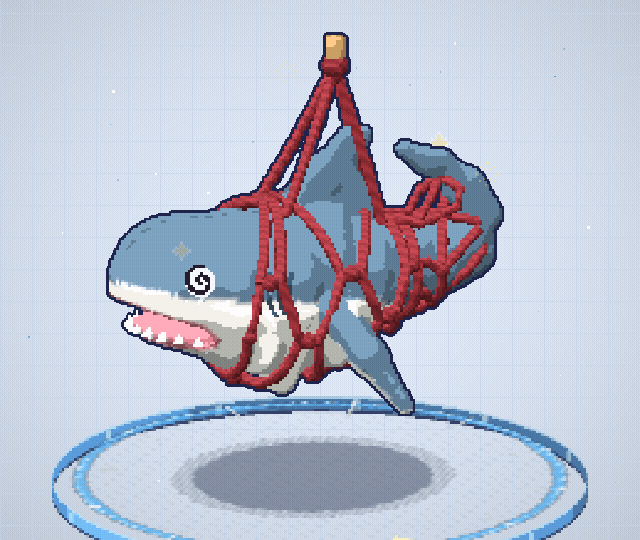
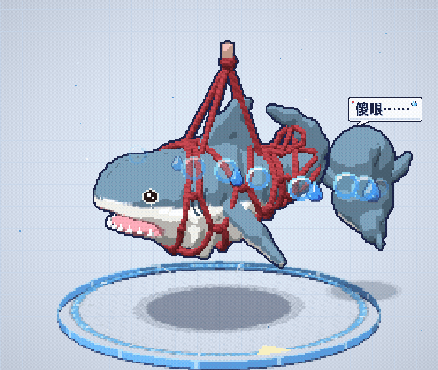
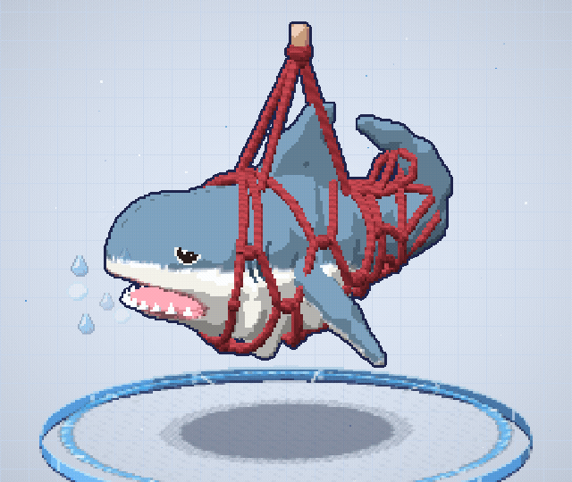
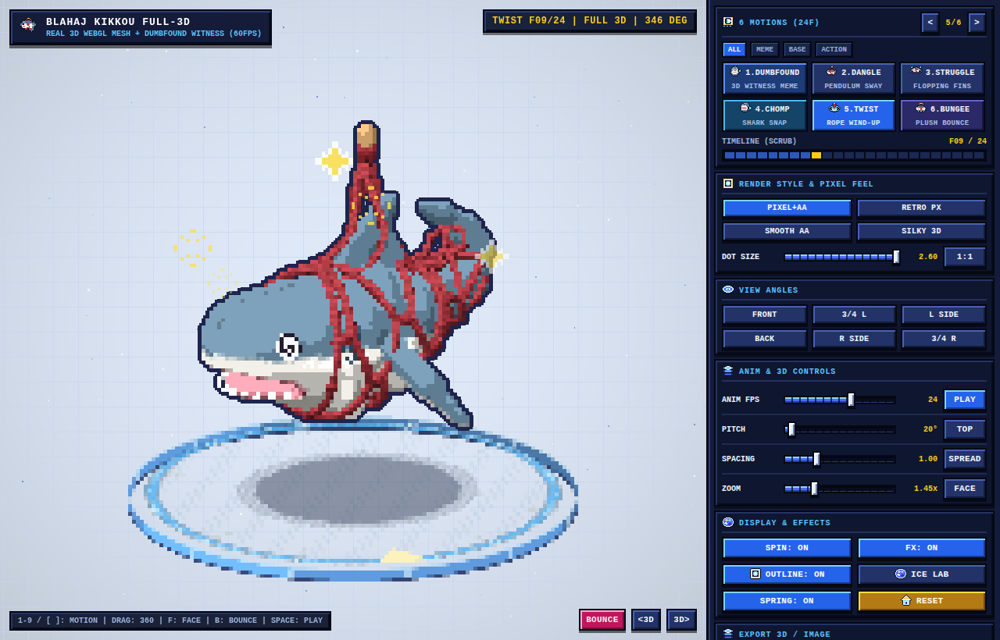

<b>English</b> &nbsp;|&nbsp; <a href="./README.ja.md">日本語 (Japanese)</a>

# BLÅHAJ KIKKOU 3D Viewer

**Interactive 3D Viewer for Kikkou-Bound IKEA Shark (Blåhaj) & "傻眼……" Witness Shark**  
**Full-3D GPU-Rigged Edition (`TWIST` × `PIXEL+AA` × `DOT SIZE 1.30` Default) · 60 FPS · Single Self-Contained HTML**

  
  
  
  
  

  <a href="https://kuraneko1.github.io/blahaj-kikkou-3d/"><b>🚀 Live Demo (`TWIST` + `PIXEL+AA 1.3`)</b></a> &nbsp;|&nbsp;
  <a href="https://kuraneko1.github.io/blahaj-kikkou-3d/smooth.html">Smooth AA Edition</a> &nbsp;|&nbsp;
  <a href="https://kuraneko1.github.io/blahaj-kikkou-3d/pseudo3d.html">128-Slice Pseudo-3D Edition</a>

---

Packed into a **single zero-dependency HTML file (`802 KB`)** with no external libraries or server required: 60° kikkou shibari ropework, tail-tie wrapping, plush belly indentation, twisting suspension-rope physics, a swimming 3D witness shark with a `"傻眼……"` (dumbfounded) pixel speech bubble, 6 interactive motions, and in-browser `.GLB` / `.PNG` export.

<table>
  <tr>
    <td align="center" width="50%">
       
      <b>5. TWIST (Default: PIXEL+AA / DOT SIZE 1.30)</b> 
      Twisting suspension rope, 360° turntable orbit, dizzy eyes &amp; sparkle FX
    </td>
    <td align="center" width="50%">
       
      <b>1. DUMBFOUND (3D Witness Shark + 傻眼……)</b> 
      Orbiting 3D witness shark with head-tracking pixel speech bubble
    </td>
  </tr>
  <tr>
    <td align="center" width="50%">
       
      <b>4. CHOMP (Shark Snap)</b> 
      Fierce squinted eyes, articulated jaw snap &amp; snout water-splash FX
    </td>
    <td align="center" width="50%">
       
      <b>Full-3D 360° &amp; Vertical Pitch Orbit (Smooth AA)</b> 
      Full `-85° to +90°` pitch, 3D frosted pedestal &amp; unified belly shading
    </td>
  </tr>
</table>

  

---

## Included Files

| File | Format / Size | Highlights &amp; Default Preset |
| :--- | :--- | :--- |
| [`index.html`](./index.html) | **Single HTML (`802 KB`)** | **Default: `5. TWIST` · `PIXEL+AA` · `DOT SIZE 1.30`** / 60 FPS Full-3D GPU Rig |
| [`smooth.html`](./smooth.html) | Single HTML (`802 KB`) | Default: `1. DUMBFOUND` · `SMOOTH AA` / Smooth-shaded edition of the same model |
| [`pseudo3d.html`](./pseudo3d.html) | Single HTML (`4.1 MB`) | 128-slice sprite-stacking edition (24 FPS / `.ap3d` import &amp; export supported) |
| [`models/blahaj-kikkou-full3d.glb`](./models/blahaj-kikkou-full3d.glb) | glTF 2.0 Binary (`765 KB`) | Ready-to-use kikkou-bound Blåhaj 3D model for Blender / Unity (38,624 tris) |
| [`models/witness-shark-full3d.glb`](./models/witness-shark-full3d.glb) | glTF 2.0 Binary (`284 KB`) | Witness shark companion 3D model (14,464 tris) |
| [`models/blahaj-shibari-3d.ap3d`](./models/blahaj-shibari-3d.ap3d) | `.ap3d` Package (`3.0 MB`) | Pseudo-3D sprite-stack package containing all 6 motions |

## Controls

- **Drag**: 360° horizontal orbit &amp; `-85° to +90°` vertical pitch (inspect the back knots and frosted-glass pedestal from any angle)
- **Mouse Wheel**: Zoom in / out
- **`1`–`6` / `[` `]`**: Switch motion (`1. DUMBFOUND` / `2. DANGLE` / `3. STRUGGLE` / `4. CHOMP` / `5. TWIST` / `6. BUNGEE`)
- **`SPACE`**: Play / Pause (click or scrub individual timeline frames)
- **`F` / `B` / `R`**: Focus face (`FACE`) / Plush bounce (`BOUNCE`) / Reset (`RESET`)
- **Export (bottom-right panel)**: Download `.GLB (3D)`, `.GLB+PET`, or `.PNG` directly from the browser

---

Built with pure GPU SDF sculpting, 2-Pass SSAA silhouettes, and `AnimeUIKit` using the [kuraneko1/anime-pseudo-3d](https://github.com/kuraneko1/anime-pseudo-3d) workflow.
